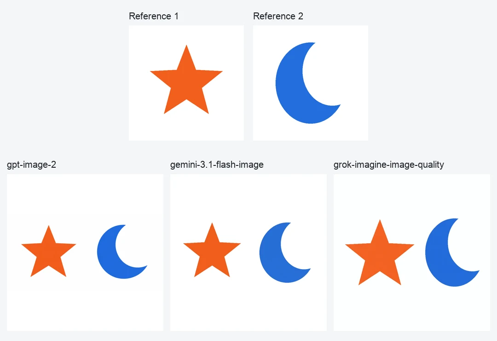

# Tako Skill

用同一把 Tako 用户 API Key，为你的 AI 助手解锁 **五大超能力**：生图与改图、视频生成与编辑、冰糖语音与声音克隆、实时联网溯源，以及跨模型外脑会诊与结构化决策。

[快速开始](docs/getting-started.md) · [图片与提示词](references/images.md) · [视频生成](references/video.md) · [冰糖语音与克隆](references/audio.md) · [网页搜索](references/search.md) · [外脑会诊](references/consult.md) · [System One](references/systemone.md) · [用量与额度](references/usage.md) · [Tako 控制台](https://tako.shiroha.tech)

> **桌面客户端用户推荐**：如果你在用 **Claude Desktop**、**Codex Desktop** 或 **Google Antigravity**，可直接使用 [Tako Switch](https://tako.shiroha.tech/tako-switch) 一键挂载内置 **6 合 1 超级 MCP**（集成搜图影音脑 + 实时额度），免去手动配置命令行与环境变量。

## 五大超能力一览

| 超能力 | 核心模型 / 入口 | 你可以这样用 | Helper / 指南 |
| --- | --- | --- | --- |
| 🎨 生图与改图 | `gpt-image-2`、`gpt-image-2.5-flare/sunburst`、`gemini-3.1-flash-image`、`grok-imagine-image-quality`、`wan2.7-image(-pro)` | 文生图、单图精修改色、多参考图融合（GPT/Gemini/Grok 已实测两图） | [`tako-image.sh`](scripts/tako-image.sh) · [图片指南](references/images.md) |
| 🎬 视频生成与编辑 | `grok-imagine-video-1.5`（支持 `480p` / `720p` / `1080p`，1–15 秒） | 文生视频、图生视频、首尾帧插值（`--last-frame`）、多参考图角色一致（`--ref-image`）、MP4 编辑与无缝续写 | [`tako-video.sh`](scripts/tako-video.sh) · [视频指南](references/video.md) |
| 🎙️ 冰糖语音与克隆 | `mimo-v2.5-tts`（默认「冰糖」）、`mimo-v2.5-tts-instruct`、`mimo-v2.5-tts-voiceclone`、`speech_asr` | 一句话冰糖配音、情绪/语速/口吻指令控制、≤10MB 样本零样本声音克隆、多语种 ASR 转写 | [`tako-audio.sh`](scripts/tako-audio.sh) · [语音指南](references/audio.md) |
| 🌐 实时联网溯源 | `POST /v1/search`（`kab` / `groq` / `grok` / `grok_x`） | 检索最新技术资料、产品文档与实时动态，返回结构化摘要与真实可引用 `results[].url` | [`tako-search.sh`](scripts/tako-search.sh) · [搜索指南](references/search.md) |
| 🧠 外脑会诊与结构化决策 | 深度会诊 `gpt-6.2-sol`（`/v1/chat/completions`）+ 结构化判别 `jev-latest`（`/v1/systemone`） | 跨模型架构/代码挑刺会诊（挑战盲点与并发竞态）＋ `Choice` / `Score` / `Noul` 确定性路由打分 | [`tako-consult.sh`](scripts/tako-consult.sh) · [外脑指南](references/consult.md) · [System One](references/systemone.md) |

---

## 实景 Demo 速览

### 1. 🎨 生图、单图精修与多参考图融合


- **三模型实景文生图**：`gpt-image-2` 陶瓷产品摄影、`gpt-image-2.5-flare` 3D 云上花园、`gpt-image-2.5-sunburst` 清晨森林木屋。[查看完整提示词与可运行命令](references/images.md#看效果三个生图例子与一次改图)。
- **单图精修对照（只改杯子颜色，保留场景光影）**：


- **双参考图融合对照（主体 + 配色迁移）**：



### 2. 🎬 视频生成与高阶编辑

一条命令自动完成异步提交、轮询直到 `SUCCESS` 并保存成品 MP4；提交 JSON 先落盘，支持 `status --task-json` 断点恢复不重复付费：

```bash
# 首尾帧平滑插值生成（支持 1–15s，480p / 720p / 1080p）
./scripts/tako-video.sh generate "镜头从开场平滑过渡到结尾" \
  --image output/first.png --last-frame output/last.png \
  --duration 6 --resolution 480p \
  --out frames-task.json --save-video output/transition.mp4
```

同时支持 `--ref-image` 多图角色/商品一致性（`@image0`、`@image1`）、`--edit-video` 自然语言重绘已有 MP4，以及 `--extend-video` 无缝续写 2–10 秒。[查看全部视频命令与直接 API 示例](references/video.md)。

### 3. 🎙️ 冰糖真声试听（3 段真实 `mimo-v2.5-tts` 音频资产）

仓库 [`assets/audio/`](assets/audio/) 内置了 3 段真实由 `mimo-v2.5-tts` 合成的冰糖音色试听资产（与 [Tako Switch](https://tako.shiroha.tech/tako-switch) 内置剧场同源）：

| 风格 | 试听文件 | 台词内容 |
| --- | --- | --- |
| 🌤 温柔叙述 | [voice-bingtang-warm.mp3](assets/audio/voice-bingtang-warm.mp3) | “在 Tako Switch 一键挂载之后，不管是写方案、做产品原型，还是给视频配一段有温度的旁白，一句话就能直接合成出来。” |
| ⚡ 灵动解说 | [voice-bingtang-lively.mp3](assets/audio/voice-bingtang-lively.mp3) | “嗨！现在的演示已经不是冷冰冰的参数表啦，你可以直接左右拖动改图滑块，或者改一句词，马上体验现场真跑的效果！” |
| 🌙 深夜电台 | [voice-bingtang-radio.mp3](assets/audio/voice-bingtang-radio.mp3) | “深夜改完最后一行代码，窗外正下着细雨。把繁琐的配置留给本地网关，把专注留给你真正想创造的作品。” |

```bash
# 冰糖默认配音（mimo-v2.5-tts）
./scripts/tako-audio.sh tts "你好，这是冰糖为你播报的今日简报。" \
  --save-audio output/briefing.mp3 --out output/briefing.json

# 情绪指令控制（自动切为 mimo-v2.5-tts-instruct）与声音克隆（自动切为 mimo-v2.5-tts-voiceclone）
./scripts/tako-audio.sh tts "窗外正下着细雨。" \
  --instructions "深夜电台旁白，沉静温柔，语速略慢" --save-audio output/radio.mp3
./scripts/tako-audio.sh tts "用参考音色朗读新台词。" \
  --voice-sample assets/audio/voice-bingtang-warm.mp3 --save-audio output/cloned.mp3

# 语音转写 ASR（speech_asr）
./scripts/tako-audio.sh asr assets/audio/voice-bingtang-warm.mp3 --language zh
```

### 4. 🌐 实时联网溯源案例

```bash
./scripts/tako-search.sh "Model Context Protocol stdio specification 2026" --count 3
```

返回结构化 `answer` 摘要与真实 `results[].url` 列表（`title`、`url`、`snippet`），方便 AI 助手严格引用真实来源而杜绝编造链接。[查看参数说明](references/search.md)。

### 5. 🧠 外脑会诊与结构化决策案例

```bash
# 深度外脑会诊（默认 gpt-6.2-sol）：挑刺并发竞态、状态机回退与幂等盲点
./scripts/tako-consult.sh \
  "异步生视频 90 秒超时重试与支付回调并发到达时，怎样避免重复扣费和状态回退？" \
  --context "客户端超时会重发请求；回调 handler 直接 UPDATE tasks SET status = \$1 WHERE id = \$2" \
  --focus "幂等键设计与单调状态转移" \
  --out output/consult.json

# 结构化判别外脑（jev-latest）：Choice / Score / Noul 确定性判断
./scripts/tako-systemone.sh "My Stripe webhook failed for 3 days!" "Is this urgent?"
```

会诊模型会直接指出「超时重发缺少业务幂等键」「无条件 `UPDATE` 导致 `settled` 终态被晚到回调覆写」并给出「超时下发 `taskId` 走只读续传 + 状态单调 `WHERE` 锁」的可落地改法。[查看双外脑对比与完整实例](references/consult.md)。

---

## 安装并开始

需要已有的 Tako 账户和用户 API Key。安装器使用 Node.js/npm；也可以把下方 `npx` 换成 `bunx`。

```bash
npx skills add tako-dev/tako-skill --skill tako-skill
```

按安装器提示选择你的 AI 工具。支持项目安装，也可加 `-g` 安装到个人目录。[指定 Claude Code / Codex、直接克隆和更新方法](docs/getting-started.md#安装与更新)。

在启动 AI 助手的同一个终端配置环境变量；Key 要复制控制台中的完整值，保留原前缀：

```bash
export TAKO_BASE_URL="https://tako.shiroha.tech"
export TAKO_API_KEY="YOUR_COMPLETE_TAKO_USER_KEY"
```

把下面这段话发给助手，先拿到一张图：

```text
使用 tako-skill，生成一张暖色陶瓷马克杯的产品摄影。
使用 gpt-image-2，把响应 JSON 和图片分别保存到 output/。
打开图片确认生成成功，再把图片给我；不要打印 API Key。
```

成功时应得到一份响应 JSON 和一张可以打开的图片。仅有 HTTP 200、模型回答“已生成”或一段 base64 都不算交付完成。

## 也可以直接运行命令

已有 Git、Bash、Python 3 和 curl 时，可以克隆仓库使用 helper，不依赖 AI 工具的 Skill 安装机制：

```bash
git clone https://github.com/tako-dev/tako-skill.git
cd tako-skill
# 在这个终端配置上面的 TAKO_API_KEY 后执行
./scripts/tako-image.sh generate "白色桌面上的红苹果，简洁摄影，无文字" \
  --out response.json --save-image output/apple.png
```

输出会显示保存路径；文件扩展名以实际图片格式为准。更多[五大超能力命令示例](examples/calls.md)。

## 按任务查文档

| 文档 | 什么时候看 |
| --- | --- |
| [快速开始](docs/getting-started.md) | 安装、设置 Key、第一次使用、更新旧版本 |
| [用量与额度](references/usage.md) | 查询当前 Key、订阅窗口、聚合消费和重试前检查 |
| [图片生成与改图](references/images.md) | 模型选择、提示词、单图/多图、接口、解码和保存 |
| [视频生成](references/video.md) | Grok 视频模型、文生视频/图生视频、首尾帧、编辑与续写 |
| [冰糖语音与克隆](references/audio.md) | 默认冰糖 TTS、情绪指令控制、≤10MB 零样本克隆与 ASR 转写 |
| [网页搜索](references/search.md) | 搜索参数、provider、回答与来源链接 |
| [外脑会诊](references/consult.md) | `tako-consult.sh` 深度会诊 vs `System One` 双外脑选型与实战示例 |
| [System One](references/systemone.md) | Choice / Score / Noul 请求及读取 `answers` |
| [命令与任务示例](examples/calls.md) | 复制一条命令或给助手一段具体任务 |
| [常见问题](docs/troubleshooting.md) | Skill 没触发、Key/额度报错、图片/音频没保存、多图怎么调用 |
| [SKILL.md](SKILL.md) | AI 助手的任务路由、调用与交付规则 |

## 当前能力边界

图片核验日期：**2026-10-04**；视频、语音与外脑能力已按最新线上网关契约接入并提供纯标准库 helper：

- **Grok 视频生成已接入**：helper 使用 `grok-imagine-video-1.5`（支持 `480p`/`720p`/`1080p`、1–15 秒生成与编辑、2–10 秒续写、首尾帧插值、多参考图一致性）。视频任务为异步提交+轮询+下载，费用按秒和分辨率计，显著高于单图。
- **冰糖语音与克隆已接入**：`tako-audio.sh` 支持 `mimo-v2.5-tts`（默认「冰糖」）、`mimo-v2.5-tts-instruct`、`mimo-v2.5-tts-voiceclone`（本地音频样本 ≤10MB）及 `speech_asr` 语音转写；所有落盘操作拒绝覆盖并校验非 JSON 错误后原子写入。
- **外脑会诊已接入**：`tako-consult.sh` 默认调用 `gpt-6.2-sol` 进行架构/代码会诊，`tako-systemone.sh` 调用 `jev-latest` 做结构化判别；二者按需配合，不互相替代。
- **多图 API 已有可用路径，图片 helper / 游乐场仍只收一张参考图。** 两张参考图已在 GPT Image 2、Gemini Flash Image、Grok Image Quality 实测；Grok 当前链路最多三张，GPT/Gemini 最大数量未验证。
- 图片编辑会重绘，不能保证区域外每个像素保持不变；蒙版、图片异步任务轮询（`/v1/images/tasks/{id}`）及 `/v1/images/variations` 工作流暂未提供。
- Key 的分组、模型权限、额度会影响你能调用的模型。超时或保存失败时先检查响应与用量，避免重复付费生成。

本仓库曾用名 `Barrierml/tako-skill` 与 `Barrierml/agent-skills` 均已自动重定向到此处；新安装请使用 `tako-dev/tako-skill`。更新命令见快速开始。

国内访问镜像的部署文件在 [`deploy/cn-mirror`](deploy/cn-mirror/README.md)，镜像上线后可从服务器域名获取文档和完整压缩包。

[MIT License](LICENSE)
